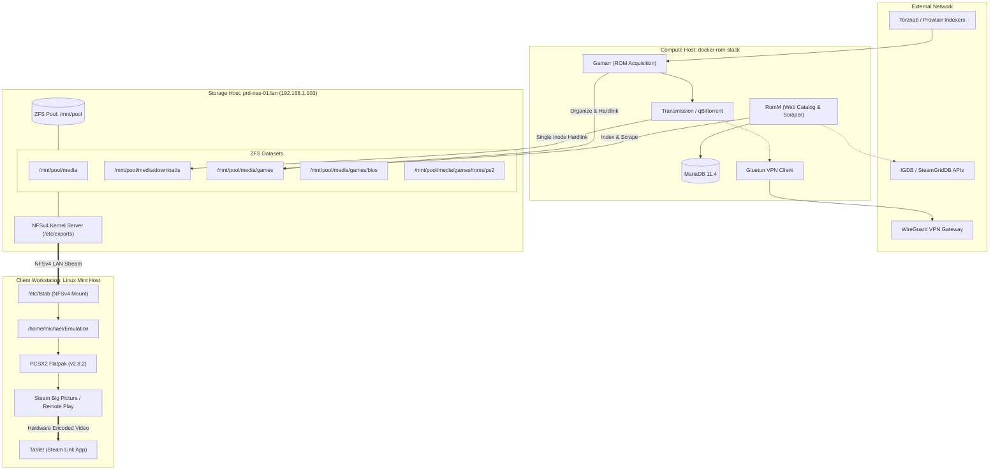
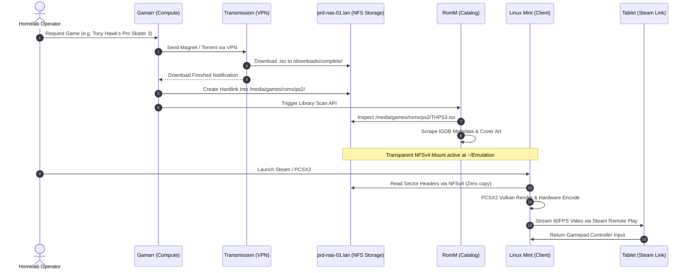

# SDD-001: ROM Stack Lifecycle, NAS Storage Allocation, and Ansible Automation

This Software Design Document (SDD) adheres to IEEE 1016-2009 and Google Design Doc standards. It defines the implementation architecture for `docker-rom-stack`, storage provisioning on `prd-nas-01.lan`, and end-to-end orchestration via Ansible.

---

## 1. Context, The Skeptic Test & Subsystem Objectives

### 1.1 Context and Technical Tension
The homelab ecosystem requires an automated, robust pipeline to acquire, index, catalog, store, and serve console emulation ROMs (e.g., Sony PlayStation 2, Nintendo GameCube, Sega Dreamcast) across heterogeneous clients:
* Headless backend servers (`prd-nas-01.lan` and compute hosts).
* Dedicated local desktop workstations (Linux Mint host with AMD Radeon RX 580).
* Remote streaming endpoints (Android/iOS tablets running Steam Link).
* Handheld retro consoles (Steam Deck, Anbernic, Retroid).

Video game ROMs present unique preservation schemas (Redump, No-Intro), massive optical disc footprints (3 GB to 8 GB per PS2 title), and sensitive network download profiles that render standard media stacks (`docker-arr-suite`, Radarr, Sonarr) incompatible.

### 1.2 The Skeptic Test: Justification of Dedicated Subsystems
* **Why not manage ROMs manually via local file copies?** Manual file management causes storage fragmentation, duplicate multi-gigabyte ISOs across multiple clients, out-of-sync save states, and broken file path references when launching via Steam.
* **Why RomM and Gamarr instead of Radarr/Sonarr?** Radarr and Sonarr are strictly bound to film and television release groups, seasons, and IMDB/TMDB identifiers. They cannot parse disc preservation checksums (CRC32, MD5, SHA-1) or query game databases (IGDB, SteamGridDB, MobyGames). Gamarr acts as an Arr-compatible manager for games, while RomM provides a dedicated browser-based catalog, web emulator interface, and metadata scraper.
* **Why centralize on `prd-nas-01.lan` via NFSv4 instead of local SSD storage?** Optical console libraries easily exceed 2 TB to 10 TB. Centralizing on ZFS pools on `prd-nas-01.lan` provides RAID-Z data protection, automated snapshotting, and atomic backups. Mounting via NFSv4 allows desktop PCSX2 and Steam Deck instances to read large disc images with near-local sequential throughput without duplicating storage.

### 1.3 Subsystem Objectives & Non-Functional Requirements
* **Preservation of Storage Efficiency:** Enforce single-inode hardlinks across download completion and library directories to eliminate cross-volume copy penalties.
* **Network Isolation:** Route all automated torrent acquisitions through WireGuard VPN tunnels with strict iptables killswitches.
* **Client Interoperability:** Provide transparent kernel-level NFS mounts (`/home/michael/Emulation`) compatible with Flatpak sandbox permissions (`--filesystem=~/Emulation`).
* **Declarative Infrastructure:** 100% of directory creation, export declarations, and client mounting must be codified in reusable Ansible playbooks.

---

## 2. Architectural Blueprint & Structural Models

### 2.1 Component Architecture Model
The following component diagram illustrates the structural decoupling between the download plane, management plane, storage plane on `prd-nas-01.lan`, and the client consumption plane:



### 2.2 Service Topology & Container Interfaces
The `docker-rom-stack` service contracts are governed by `compose.yml`:
* **`romm-db`:** MariaDB 11.4 backing store for RomM catalog metadata, user sessions, and collection tags. Healthchecked via `mysqladmin ping` / `healthcheck.sh`.
* **`romm`:** RomM v3.7.2 web UI and REST API. Connects to `romm-db`, mounts `/romm/library` from the shared storage pool, and authenticates against IGDB and SteamGridDB.
* **`gamarr`:** Arr-style automation daemon monitoring game releases, communicating with Prowlarr via Torznab, and sending torrent hashes to the download client.

### 2.3 Volume Binding & Cross-Stack Decoupling
To preserve atomic hardlinks, `compose.yml` mounts a unified storage root (`${MEDIA_DIR:-/mnt/nas/media}`) rather than isolated sub-volume mounts. This ensures that `/downloads` and `/games` share the same filesystem superblock inside the container namespaces.

---

## 3. Dynamic Execution & Ingestion Lifecycle

### 3.1 End-to-End Sequence Model
The following sequence details the lifecycle from title search to tablet streaming:



### 3.2 Ingestion & Hardlink Rules
1. **Preservation of Seeds:** The torrent client stores incoming files in `/mnt/pool/media/downloads/games/`.
2. **Atomic Linking:** Gamarr creates a hardlink (`link()`) into `/mnt/pool/media/games/roms/<platform>/<title>.<ext>`. No disk blocks are duplicated.
3. **Scan Triggers:** Upon hardlink creation, Gamarr notifies RomM's webhook endpoint (`POST /api/library/scan`), triggering checksum identification against `database.json` and Redump catalogs.

---

## 4. Storage Allocation Architecture on `prd-nas-01.lan`

### 4.1 ZFS Dataset Hierarchy
On `prd-nas-01.lan` (192.168.1.103), storage allocation is structured as follows:

```text
/mnt/pool/
└── media/
    ├── downloads/
    │   └── games/          # Raw torrent payload data
    └── games/
        ├── bios/           # Master firmware repository (retrobios mirror)
        ├── roms/
        │   ├── ps2/        # PlayStation 2 ISO / CHD disc images
        │   ├── psx/        # PlayStation 1 images
        │   └── snes/       # Super Nintendo ROMs
        └── saves/          # Centralized emulator memory card states
```

### 4.2 NFSv4 Export Specification
The storage host runs the Linux NFS kernel server (`nfs-kernel-server`). The export definition in `/etc/exports` enforces:

```text
/mnt/pool/media/games 192.168.1.0/24(rw,sync,no_subtree_check,all_squash,anonuid=999,anongid=110)
```

* **`no_subtree_check`:** Eliminates path inspection overhead on deeply nested ROM directories, preventing transfer pauses.
* **`all_squash,anonuid=999,anongid=110`:** Forces all client read/writes to map to the standardized homelab media user (`PUID=999`, `PGID=110`), resolving cross-host permission conflicts.

---

## 5. Ansible Homelab Automation Specifications

Ansible orchestration is divided into two decoupled roles following Homelab Systems Lifecycle (HSL) standards:

### 5.1 Host Role: `storage_nas_emulation` (Target: `prd-nas-01.lan`)
* **Role Path:** `~/src/github.com/mnaatjes/homelab/ansible/roles/storage_nas_emulation`
* **Tasks:**
  1. Ensure base ZFS datasets exist using `community.general.zfs`.
  2. Create directory skeleton with ownership `999:110` and permissions `0775`.
  3. Template `/etc/exports.d/emulation.exports`.
  4. Ensure `nfs-kernel-server` is enabled and reloads exports (`exportfs -ra`).

### 5.2 Client Role: `emulation_workstation_client` (Target: Linux Mint / Workstations)
* **Role Path:** `~/src/github.com/mnaatjes/homelab/ansible/roles/emulation_workstation_client`
* **Tasks:**
  1. Install prerequisite utilities (`nfs-common`, `flatpak`).
  2. Ensure local mount point `/home/michael/Emulation` exists.
  3. Register persistent NFS mount in `/etc/fstab` with mount options:
     `nfs4 _netdev,auto,nofail,soft,intr,rsize=1048576,wsize=1048576 0 0`
  4. Enforce Flatpak filesystem override:
     `flatpak override --user --filesystem=/home/michael/Emulation net.pcsx2.PCSX2`

---

## 6. Implementation Roadmap & Phased PR Sequencing

### Phase 1: Repository Finalization (`docker-rom-stack`)
* [ ] Finalize `.env.example` with standard ports (`ROMM_PORT=8082`, `GAMARR_PORT=8790`).
* [ ] Commit SDD-001 and ADR 0001 index updates to `main`.
* [ ] Push repository state to upstream `origin/main`.

### Phase 2: NAS Storage & NFS Export Allocation (`prd-nas-01.lan`)
* [ ] Connect to `prd-nas-01.lan` and provision `/mnt/pool/media/games/{roms/ps2,bios,saves}`.
* [ ] Apply `chown -R 999:110` and `chmod -R 775`.
* [ ] Apply `/etc/exports` configuration and reload `exportfs -ra`.
* [ ] Sync local BIOS files (from `Abdess/retrobios`) into `/mnt/pool/media/games/bios/`.

### Phase 3: Ansible Codification & Client Mount
* [ ] Author Ansible playbooks `provision_nas_emulation.yml` and `mount_client_emulation.yml`.
* [ ] Execute playbook against `prd-nas-01.lan` and `localhost`.
* [ ] Verify `/home/michael/Emulation` mounts remote storage automatically.
* [ ] Validate that PCSX2 scans and launches `THPS3.iso` over the active NFS mount.

---

## 7. Quality Verification & Acceptance Test Matrix

| ID | Test Target | Verification Command / Procedure | Expected Result |
| :--- | :--- | :--- | :--- |
| **TC-01** | Git Status | `git -C ~/src/github.com/mnaatjes/docker-rom-stack status` | Working tree clean, synced with `origin/main`. |
| **TC-02** | NAS Export | `showmount -e prd-nas-01.lan` | Displays `/mnt/pool/media/games` available to subnet. |
| **TC-03** | Client Mount | `mountpoint -q /home/michael/Emulation` | Returns exit code `0` (active NFSv4 filesystem). |
| **TC-04** | Flatpak Read | `flatpak run --command=ls net.pcsx2.PCSX2 /home/michael/Emulation/roms/ps2` | Lists `THPS3.iso` without permission errors. |
| **TC-05** | Emulation Stream | Launch shortcut from Steam Link on tablet | 60 FPS video stream, gamepad input recognized. |
