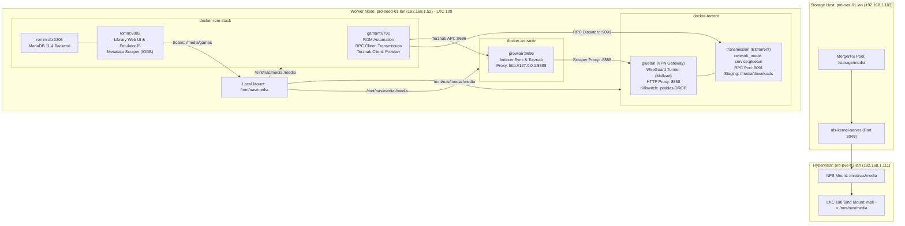
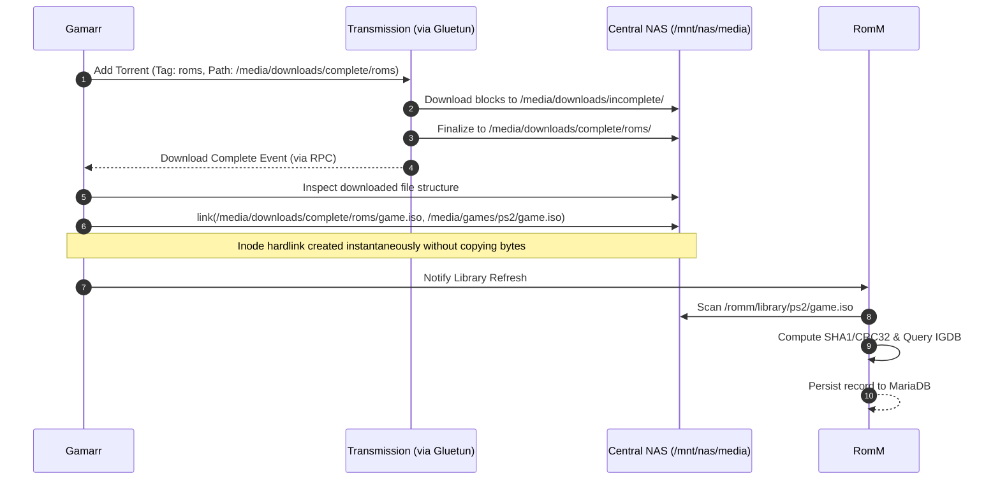

# SDD-002: ROM Acquisition Pipeline, VPN Killswitch Isolation, and Cross-Stack Orchestration

## 1. Executive Summary & Policy Distillation

### 1.1 Policy Context
This Software Design Document (SDD) establishes the authoritative technical blueprint for `docker-rom-stack`. Per [ADR 0001](file:///home/michael/src/github.com/mnaatjes/docker-rom-stack/architecture/adr/0001_rom_stack_cross_stack_integration_and_storage_architecture.md), the emulation automation subsystem is deployed as an independent container stack hosted on worker node `prd-seed-01.lan` (`192.168.1.52`, LXC 108 on hypervisor `prd-pve-02.lan`), co-located with `docker-torrent` and `docker-arr-suite`.

### 1.2 Objectives
1. **Automate Game Acquisition:** Interface Gamarr with Prowlarr (`:9696`) to discover and index console/computer ROM releases across Usenet and BitTorrent.
2. **Guarantee Privacy via VPN Killswitch:** Confine all BitTorrent peer traffic to Gluetun's WireGuard tunnel (`docker-torrent`) via Transmission RPC delegation.
3. **Prevent Storage Duplication:** Enforce atomic zero-copy hardlinks (`link()`) between download staging directories and library storage across the central NFS pool (`/mnt/nas/media`).
4. **Deliver Centralized Emulation:** Host RomM 3.7.2 and MariaDB 11.4 to provide in-browser WebAssembly emulation, box art scraping (IGDB), and save state synchronization.

### 1.3 Design Invariants & Guarantees
* **Invariant 1 (Zero-Leak BitTorrent Execution):** `docker-rom-stack` shall contain no internal BitTorrent client engines. All downloads are dispatched to Transmission over RPC (`:9091`), which is strictly bound to Gluetun's network namespace (`network_mode: "service:gluetun"`).
* **Invariant 2 (Cross-Volume Isolation Banned):** Both Gamarr and RomM shall mount the central NAS media root at `/media` or `/mnt/nas/media/games`. Staging and final libraries share the same physical filesystem branch, guaranteeing that file moves execute as $O(1)$ atomic hardlinks without data duplication.
* **Invariant 3 (Identity Consistency):** All container processes shall run with `PUID=999` and `PGID=110` (`seedbox-sys:media`), matching permissions across `prd-nas-01.lan` and hypervisor LXC mounts.
* **Invariant 4 (Port Uniqueness):** Gamarr binds host port `8790` (preventing collision with Readarr on `8787`), and RomM binds host port `8082`.

---

## 2. Architectural Blueprint & Component Models

### 2.1 Multi-Stack Component & Network Architecture



---

## 3. Data Storage & Filesystem Architecture

### 3.1 Directory Topology on Central NAS Pool (`prd-nas-01.lan`)

```text
/mnt/nas/media/
├── downloads/
│   ├── complete/
│   │   ├── movies/
│   │   ├── tv/
│   │   └── roms/               <-- Staging destination for Transmission payloads
│   └── incomplete/             <-- Active BitTorrent download chunks
└── games/                      <-- Clean ROM and disc image repository
    ├── ps2/                    <-- Sony PlayStation 2 ISOs / CHDs
    │   ├── Metal Gear Solid 2/
    │   └── THPS3/
    ├── snes/                   <-- Super Nintendo SFC / SMC ROMs
    ├── gba/                    <-- Game Boy Advance GBA ROMs
    └── saves/                  <-- Centralized RomM and emulator save states
```

### 3.2 Persistent State Mapping (HSL Compliance)
All mutable configuration files, relational databases, and static assets reside under the HSL persistent path `/opt/homelab/prod/data/docker-rom-stack/`:

| Directory | Volume Target | Host Path | Owner:Group | Mode |
| :--- | :--- | :--- | :--- | :--- |
| **Gamarr Config** | `/config` | `/opt/homelab/prod/data/docker-rom-stack/gamarr` | `999:110` | `0775` |
| **RomM Config** | `/romm/config` | `/opt/homelab/prod/data/docker-rom-stack/romm/config` | `999:110` | `0775` |
| **RomM Assets** | `/romm/resources`| `/opt/homelab/prod/data/docker-rom-stack/romm/resources` | `999:110` | `0775` |
| **MariaDB State** | `/var/lib/mysql` | `/opt/homelab/prod/data/docker-rom-stack/mysql` | `999:110` | `0750` |

---

## 4. Cross-Stack Dynamic Behavior & Workflows

### 4.1 Ingestion and Hardlink Lifecycle



---

## 5. Operational Governance & Runbook Verification

### 5.1 Preflight & Deployment Verification
Prior to starting `docker-rom-stack`, the operator or Ansible control runner must verify:
1. `docker-torrent` is active and Gluetun displays `HEALTHY`:
   ```bash
   docker inspect --format='{{.State.Health.Status}}' gluetun
   ```
2. Transmission RPC responds with HTTP 401 (Authentication Required):
   ```bash
   curl -s -o /dev/null -w "%{http_code}" http://192.168.1.52:9091/transmission/rpc
   ```
3. Prowlarr web API responds on port `9696`:
   ```bash
   curl -s -o /dev/null -w "%{http_code}" http://192.168.1.52:9696/api/v1/system/status
   ```

### 5.2 Hardlink Integrity Audit
Verify that imported games share the exact physical inode with the active seeding torrent:
```bash
ls -i "/mnt/nas/media/downloads/complete/roms/THPS3.iso" "/mnt/nas/media/games/ps2/THPS3.iso"
# Expected: Both outputs display identical inode integer numbers.
```
