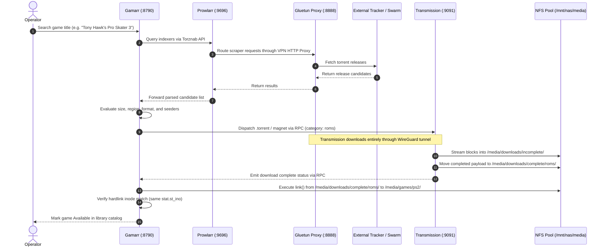

# UC-01: Automated ROM Acquisition, BitTorrent Download, and Inode Ingest

## 1. Metadata & Specification Level

* **Identifier:** `UC-01`
* **Title:** Automated ROM Acquisition, BitTorrent Download, and Inode Ingest
* **Scope:** `docker-rom-stack` (Gamarr) $\leftrightarrow$ `docker-torrent` (Transmission) $\leftrightarrow$ `docker-arr-suite` (Prowlarr)
* **Level:** Sea-Level (User Goal)
* **Primary Actor:** Homelab Operator / Automated Acquisition Daemon
* **Stakeholders & Interests:**
  * **Operator:** Desires zero-touch searching, verified downloads, automated categorization, and immediate emulator availability without copyright exposure.
  * **Network Security Plane:** Demands 100% of torrent payload packets remain encapsulated in the WireGuard VPN tunnel.
  * **Storage Host (`prd-nas-01.lan`):** Demands zero disk duplication during seeding operations.

---

## 2. Preconditions & Postconditions

### Preconditions
1. `docker-rom-stack` is running on `prd-seed-01.lan` with network connectivity to `docker-arr-suite` (`192.168.1.52:9696`) and `docker-torrent` (`192.168.1.52:9091`).
2. Central NFS share `/mnt/nas/media` is mounted on `prd-seed-01.lan` with read/write permissions for UID `999:110`.
3. Prowlarr has at least one active gaming indexer tagged with Console (1000) or PC (4000) categories.
4. Transmission is running attached to Gluetun's WireGuard tunnel with the active killswitch enabled.

### Postconditions
1. The requested game disc or cartridge ROM is downloaded to `/mnt/nas/media/downloads/complete/roms/`.
2. An atomic hardlink is instantiated in `/mnt/nas/media/games/<platform>/<title>/`.
3. Transmission continues seeding the file in the download directory with zero storage overhead.
4. Gamarr marks the title status as downloaded and notifies RomM to trigger library scanning.

---

## 3. Main Success Scenario (Happy Path)

### Detailed Execution Steps
1. **Query Initiation:** The operator requests a game title via Gamarr web interface or API.
2. **Indexer Proxying:** Gamarr queries Prowlarr (`:9696`). Prowlarr forwards search queries through Gluetun's HTTP proxy (`:8888`), masking the local WAN IP.
3. **Release Selection:** Gamarr evaluates matches against quality profiles (e.g., USA/PAL preference, Redump verification, CHD/ISO format).
4. **Client Dispatch:** Gamarr pushes the chosen magnet link to Transmission (`:9091`) with label `roms`.
5. **VPN Downloading:** Transmission downloads payload chunks strictly through Gluetun's WireGuard interface.
6. **Payload Finalization:** Transmission completes the download, moves data into `/mnt/nas/media/downloads/complete/roms/`, and reports completion over RPC.
7. **Atomic Hardlink Ingest:** Gamarr creates an atomic hardlink inside `/mnt/nas/media/games/<platform>/<title>/`.
8. **Catalog Update:** Gamarr logs the completed import and records media metadata.

---

## 4. Alternate & Exception Flows

### 4a. Transmission RPC Unavailable or Connection Refused
* **Trigger:** `docker-torrent` container is stopped or restarting.
* **Flow:**
  1. Gamarr fails to connect to `192.168.1.52:9091/transmission/rpc`.
  2. Gamarr queues the download command locally and retries with exponential backoff (15s, 30s, 60s).
  3. Operator is alerted in Gamarr UI if client connection fails after 5 retries.

### 4b. Cross-Device Hardlink Failure (`EXDEV`)
* **Trigger:** Staging path and library destination reside on distinct filesystem mount points.
* **Flow:**
  1. Linux kernel returns `EXDEV` (Invalid cross-device link) when `link()` is invoked.
  2. Gamarr detects hardlink failure and halts the import to prevent expensive multi-gigabyte disk copying.
  3. An administrative alert is logged: `Hardlink failed: Ensure /media root volume is identically mounted across containers`.

### 4c. VPN Tunnel Drop During Active Download
* **Trigger:** Mullvad WireGuard endpoint disconnects or handshakes expire.
* **Flow:**
  1. Gluetun's kernel killswitch drops all incoming and outgoing non-WireGuard traffic instantly.
  2. Transmission stalls active downloads immediately; zero packets leak to the local gateway (`192.168.1.1`).
  3. Gamarr marks the task as stalled until Gluetun establishes a healthy tunnel and resume occurs automatically.
