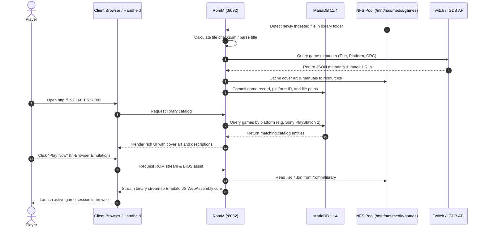

# UC-02: Scrape Metadata, Index ROMs, and Serve Emulation Clients

## 1. Metadata & Specification Level

* **Identifier:** `UC-02`
* **Title:** Scrape Metadata, Index ROMs, and Serve Emulation Clients
* **Scope:** `docker-rom-stack` (RomM, MariaDB) $\leftrightarrow$ NFS Storage (`/mnt/nas/media/games`) $\leftrightarrow$ External (Twitch/IGDB) $\leftrightarrow$ Client Devices
* **Level:** Sea-Level (User Goal)
* **Primary Actor:** Homelab User / Emulation Player
* **Stakeholders & Interests:**
  * **User:** Wants instant access to box art, manuals, screenshots, browser-based play, and save synchronization across devices (PC, Steam Deck, Anbernic).
  * **Database Backend (`romm-db`):** Requires consistent relational storage for game metadata, tags, and play tracking.

---

## 2. Preconditions & Postconditions

### Preconditions
1. RomM container and MariaDB 11.4 backend are running and healthy on `prd-seed-01.lan`.
2. Clean ROM or disc images are present in `/mnt/nas/media/games/<platform>/`.
3. Valid Twitch developer credentials (`IGDB_CLIENT_ID`, `IGDB_CLIENT_SECRET`) are configured in `.env`.
4. Client browser or handheld device has network access to `http://192.168.1.52:8082`.

### Postconditions
1. The game title is indexed into the MariaDB database with full metadata (release year, developer, genre, rating).
2. High-resolution cover art, screenshots, and manuals are cached in `/opt/homelab/prod/data/docker-rom-stack/romm/resources/`.
3. The game can be launched directly in-browser via EmulatorJS or downloaded on demand to client devices.
4. Save states and battery saves synchronize back to `/mnt/nas/media/games/saves/`.

---

## 3. Main Success Scenario (Happy Path)

### Detailed Execution Steps
1. **Library Ingest:** RomM detects a new file imported by Gamarr or manually deposited in `/mnt/nas/media/games/<platform>/`.
2. **Metadata Matching:** RomM parses the filename and queries the Twitch IGDB API over HTTPS.
3. **Asset Caching:** High-resolution box art, title screens, and manuals are fetched and saved locally in `data/romm/resources/` to avoid redundant external API calls.
4. **Relational Persistence:** The game record, metadata, and platform relationships are saved to MariaDB.
5. **Client Presentation:** The operator accesses RomM via desktop browser or mobile client, filtering games by platform, genre, or release year.
6. **Execution / Download:** The user either plays the title directly in the browser via EmulatorJS WebAssembly, or downloads the raw ROM payload to a dedicated handheld emulator.
7. **Save State Sync:** Game saves generated during gameplay are persisted back to `/mnt/nas/media/games/saves/`.

---

## 4. Alternate & Exception Flows

### 4a. Title Ambiguity or IGDB Mismatch
* **Trigger:** Filename does not strictly match IGDB database title strings.
* **Flow:**
  1. RomM places the item in the "Unmatched Games" review queue.
  2. The user navigates to the item in RomM and selects "Edit Metadata".
  3. The user searches by IGDB ID or custom string, selects the correct game profile, and RomM re-indexes the record.

### 4b. MariaDB Connectivity Loss
* **Trigger:** `romm-db` container crashes or fails its healthcheck.
* **Flow:**
  1. RomM logs database connection timeout and pauses library scanning.
  2. Docker engine healthcheck flags `romm-db` as unhealthy.
  3. Systemd / Docker auto-restart attempts container recovery; upon MariaDB health restoration, RomM re-establishes connection pool automatically.
